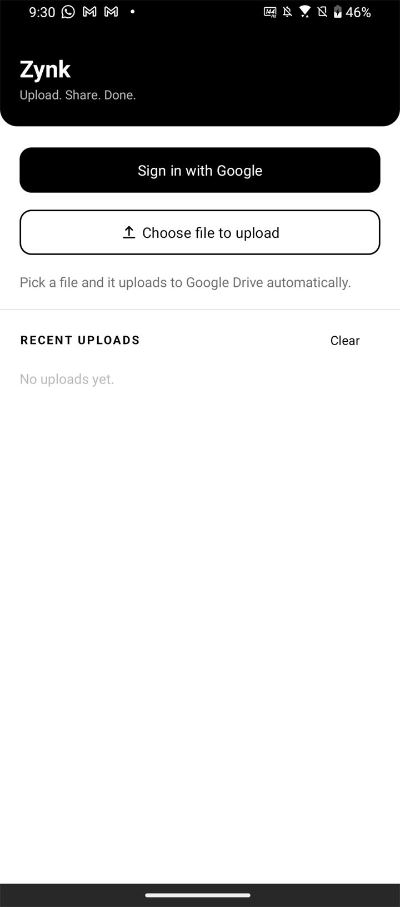
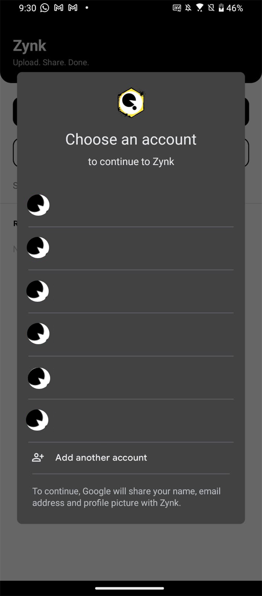
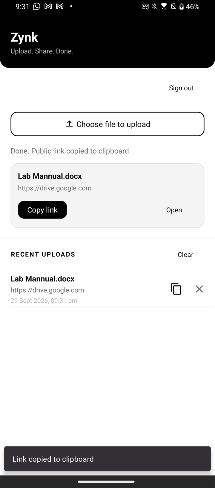

# QuickShare

[](LICENSE)
[](https://developer.android.com/about/versions/oreo)
[](https://kotlinlang.org)
[](https://www.android.com)

**Pick a file → it's on your Drive, public, and the link is already on your clipboard.**

QuickShare is a tiny native Android app with no server, no account of its own, and no
clutter. You sign in with Google, choose any file, and it uploads to **your own Google
Drive**, sets it to *anyone with the link can view*, copies the link, and remembers it
in a local history.

---

## Features ✨

- **Sign in with Google** — only the Drive scope, nothing else
- **Any file type** — photos, PDFs, videos, zips, documents
- **Automatic upload** — starts the instant you pick the file
- **Public link** — file is set to *anyone with the link can view*
- **Auto-copied** — the shareable link lands in your clipboard and on screen
- **History** — every upload saved locally; tap to copy again, ✕ to remove, *Clear* to wipe
- **Self-healing** — re-asks for Drive permission automatically when Google's 7-day grant expires
- **Minimal UI** — white background, black accents, Material 3

## Screenshots

| | | |
|:---:|:---:|:---:|
|  |  |  |
|  |  |  |

---

## Requirements

- Android Studio (or JDK 17 + the Android SDK)
- A Google account
- A free Google Cloud project — see below

## 1. Build the app

```bash
git clone https://github.com/OWNER/QuickShare.git
cd QuickShare
```

Open in **Android Studio** → let Gradle sync → **Run ▶**.

Or from the terminal:

```bash
./gradlew assembleDebug
# → app/build/outputs/apk/debug/app-debug.apk
```

On Windows PowerShell you may first need:

```powershell
$env:JAVA_HOME = "C:\Program Files\Android\Android Studio\jbr"
```

Every push to `main` also builds automatically via GitHub Actions
([`.github/workflows/android.yml`](.github/workflows/android.yml)) — grab the APK
from the workflow's **Artifacts**.

## 2. Google Cloud setup (one-time, required)

The app talks directly to Google Drive, so you must register it once.
**Without this step, sign-in fails with `Error 403: access_denied`.**

### a. Create a project & enable the Drive API

1. <https://console.cloud.google.com/> → **New Project** → **Create**
2. **APIs & Services → Library** → search **Google Drive API** → **Enable**

### b. OAuth consent screen

1. **APIs & Services → OAuth consent screen** → User type **External** → **Create**
2. App name, support email, developer contact → **Save and Continue**
3. **Scopes → Add or Remove Scopes**, add:
   - `https://www.googleapis.com/auth/userinfo.email`
   - `https://www.googleapis.com/auth/drive.file`
4. **Test users → Add users** → every Gmail that should be able to sign in → **Save**

> `drive.file` is a *sensitive* scope. While the app is in **Testing** only listed test
> users can sign in (up to 100). Want **anyone** to sign in? Click **Publish app** —
> users then tap *Advanced → Go to \<app name\>* on the unverified-app warning.

### c. Android OAuth client

1. **APIs & Services → Credentials → Create Credentials → OAuth client ID**
2. Application type: **Android**
3. **Package name:** `com.quickshare.app`
4. **SHA-1 certificate fingerprint** — your own debug fingerprint:

```bash
keytool -list -v -keystore ~/.android/debug.keystore -alias androiddebugkey -storepass android
```

Windows (Android Studio's bundled JDK):

```powershell
& "C:\Program Files\Android\Android Studio\jbr\bin\keytool.exe" -list -v `
  -keystore "$env:USERPROFILE\.android\debug.keystore" `
  -alias androiddebugkey -storepass android
```

Or in Android Studio: **Gradle → Tasks → android → signingReport**.

> There is **no client ID to paste into the code** — Play Services finds this
> credential from your package name + SHA-1. A mismatch shows up as
> `Google Drive permission problem: …` in the app.

## 3. How to use it

1. **Sign in with Google** → pick your account → **Allow**
2. **Choose file to upload** → pick anything from your phone
3. Wait a second — it uploads, makes the file public, copies the link
4. Find it under **Recent Uploads**
   - tap the row → open the link in the browser
   - tap ✕ → remove it from history (the Drive file stays)
   - **Clear** → wipe the whole history

The file lands in **your own** Google Drive root, shareable by anyone with the link.

## 4. Release build (optional)

```bash
./gradlew assembleRelease
```

The release APK is unsigned until you add a signing config. If you create a release
keystore, add a **second Android OAuth client** in Google Cloud using that keystore's
SHA-1, or sign-in will fail on the release build.

```bash
keytool -genkey -v -keystore release.keystore -alias quickshare -keyalg RSA -keysize 2048 -validity 10000
```

> ⚠️ Never commit `*.keystore` / `*.jks`.

## Publishing to Google Play

Store listing text already lives in
[`fastlane/metadata/android/en-US/`](fastlane/metadata/android/en-US) — title,
short/full description, and the v1 changelog.

Before publishing you still need to:

1. Replace the placeholders in `contact_email.txt`, `contact_website.txt`,
   `privacy_policy_url.txt`
2. Drop in `icon.png` (512×512), `featureGraphic.png` (1024×500) and phone screenshots
   under `images/`
3. Publish the OAuth consent screen **and complete Google's scope verification** for
   `drive.file` — Play will reject an unverified app that requests a sensitive scope
4. Ship an **`.aab`**, not an APK:

```bash
./gradlew bundleRelease
```

---

## Project structure

```
.
├── .github/
│   ├── workflows/android.yml       CI: builds the APK, publishes tagged releases
│   ├── ISSUE_TEMPLATE/             bug report + feature request forms
│   └── PULL_REQUEST_TEMPLATE.md
├── asset/screenshot/               README screenshots
├── fastlane/metadata/              Google Play store listing
├── app/src/main/
│   ├── java/com/quickshare/app/
│   │   ├── MainActivity.kt         UI, sign-in, upload flow, clipboard, history
│   │   ├── DriveService.kt         OAuth token, multipart upload, make public, link
│   │   ├── HistoryAdapter.kt       RecyclerView adapter
│   │   └── data/HistoryDb.kt       SQLiteOpenHelper + HistoryItem
│   ├── res/                        layouts, drawables, themes (white + black)
│   └── AndroidManifest.xml
├── CONTRIBUTING.md
├── CODE_OF_CONDUCT.md
├── PRIVACY_POLICY.md
├── LICENSE                         MIT
└── README.md
```

| Concern | Where |
|---|---|
| Requesting Drive permission | `DriveService.SCOPE` |
| Uploading the file | `DriveService.upload()` → `POST /upload/drive/v3/files?uploadType=multipart` |
| Making it public | `DriveService.makePublic()` → `POST /drive/v3/files/{id}/permissions` |
| Share link | `DriveService.shareLink()` → `https://drive.google.com/file/d/{id}/view?usp=sharing` |
| History storage | `data/HistoryDb.kt` (table `history`) |

## Troubleshooting

| Symptom | Cause / fix |
|---|---|
| `Error 403: access_denied` on sign-in | Not a test user. Add it under OAuth consent screen → Test users, or click **Publish app**. |
| `Google Drive permission problem: …` | Package name or SHA-1 doesn't match the Android OAuth client. Re-check `com.quickshare.app` and your debug SHA-1 (~5 min to apply). |
| *"Google hasn't verified this app"* | Expected while unverified. Tap **Advanced → Go to \<app\>**. Complete Google's verification to remove it. |
| Asks for permission again every ~7 days | Normal — refresh tokens expire after 7 days in *Testing*. The app re-asks automatically. |
| `Drive error (HTTP 4xx)` in red text | Google's explanation is included — usually quota, network, or a permission change. |

## Contributing

Contributions are welcome — see [CONTRIBUTING.md](CONTRIBUTING.md) for the workflow and
[CODE_OF_CONDUCT.md](CODE_OF_CONDUCT.md) for community standards.

1. Open an issue first so the change is agreed before the code exists
2. Fork and branch from `main`
3. Make sure `./gradlew assembleDebug` passes
4. Open a PR and fill in the template

## Privacy

No backend, no trackers, no analytics. Your file goes straight from your phone to your
own Google Drive over Google's official API. The only thing stored on the device is a
local list of file names, links and timestamps — clear it from the app or uninstall.

Full details: [PRIVACY_POLICY.md](PRIVACY_POLICY.md)

## License

[MIT](LICENSE) — free to use, modify, and redistribute.
